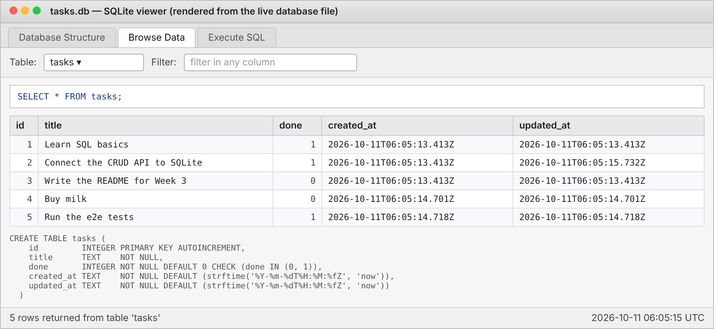

# Week 3 · A2 — Connecting the CRUD API to a database

FlyRank AI Internship · Backend AI Engineering · BE-02

A Tasks CRUD API built with **Express** that stores its data in a real **SQLite** database
(`tasks.db`) instead of an in-memory array. The API surface is unchanged from the in-memory
version — same URLs, same request bodies, same responses — but tasks now survive server restarts.

```
Before:  Client -> API -> Array in memory
Now:     Client -> API -> SQLite (tasks.db)
```

## Why SQLite?

- **Zero setup.** SQLite is a library, not a server. There is nothing to install or run
  alongside the API — `better-sqlite3` opens the file directly, and creates it if it is missing.
- **One file.** The whole database is a single `tasks.db` file next to the code, which makes it
  trivial to inspect (any SQLite viewer), back up (copy the file) or reset (delete the file).
- **Real SQL.** Everything the API does — reads, inserts, updates, deletes, filtering, counting —
  is done with SQL queries, so the skills transfer directly to PostgreSQL/MySQL later. The data
  layer is isolated in `db.js`; swapping it for Postgres would not change a single endpoint.
- **Right-sized.** For a single Node process and a small dataset, SQLite is faster and simpler
  than a networked database. It is the correct default until there is a reason to outgrow it.

## Where the database file is stored

`tasks.db` is created **automatically on first start** in the project root (same folder as
`server.js`). It is listed in `.gitignore` so it is never committed — anyone cloning the repo gets
a fresh database the first time they run the project.

| File | Purpose |
|------|---------|
| `tasks.db` | The database (created on first run) |
| `tasks.db-wal`, `tasks.db-shm` | SQLite write-ahead-log helper files (safe to ignore) |

You can point the API at a different location with the `DB_PATH` environment variable, e.g.
`DB_PATH=/data/tasks.db npm start`. The test suite uses this to run against a throw-away file.

## How to start the project

Requires Node.js 18+ (uses the built-in `fetch` in the tests).

```bash
git clone https://github.com/ayuceman/flyrank.git
cd flyrank/BE-02-crud-sqlite
npm install
npm start
```

On the first start you will see:

```
tasks.db was empty — inserted 3 example tasks
Server listening on http://localhost:3000
```

Restart as many times as you like — the seed runs **only when the table is empty**, so the
three example tasks appear exactly once.

```bash
npm test        # end-to-end checks (16), including a real server restart
npm run dev     # auto-restart on file changes
```

## What happens on startup (`db.js`)

1. Open (or create) `tasks.db`.
2. `CREATE TABLE IF NOT EXISTS tasks (...)` — the schema below.
3. `SELECT COUNT(*) FROM tasks` — if it is `0`, insert three example tasks inside a transaction.

```sql
CREATE TABLE IF NOT EXISTS tasks (
  id         INTEGER PRIMARY KEY AUTOINCREMENT,
  title      TEXT    NOT NULL,
  done       INTEGER NOT NULL DEFAULT 0 CHECK (done IN (0, 1)),   -- SQLite has no BOOLEAN
  created_at TEXT    NOT NULL DEFAULT (strftime('%Y-%m-%dT%H:%M:%fZ', 'now')),
  updated_at TEXT    NOT NULL DEFAULT (strftime('%Y-%m-%dT%H:%M:%fZ', 'now'))
);
```

`done` is stored as `0`/`1` in the database and converted to `true`/`false` in the JSON, so
clients see exactly the same shape as before.

## API

| Method | Path | Body | Success | Errors |
|--------|------|------|---------|--------|
| GET | `/tasks` | — | `200` array of tasks | — |
| GET | `/tasks/:id` | — | `200` task | `404` |
| POST | `/tasks` | `{ "title": "...", "done"?: bool }` | `201` new task | `400` |
| PUT | `/tasks/:id` | `{ "title"?: "...", "done"?: bool }` | `200` updated task | `400`, `404` |
| DELETE | `/tasks/:id` | — | `204` | `404` |
| GET | `/stats` | — | `200` `{ total, done, pending }` | — |
| GET | `/health` | — | `200` `{ status: "ok" }` | — |

Unknown ids return `404 { "error": "Task not found" }`.
Invalid bodies (missing/blank title, non-boolean `done`, malformed JSON) return `400 { "error": "..." }`.

Optional query parameters on `GET /tasks` — all evaluated in SQL, not JavaScript:

| Query | SQL | Example |
|-------|-----|---------|
| `?search=milk` | `WHERE title LIKE '%milk%'` | `/tasks?search=milk` |
| `?done=true` / `?done=false` | `WHERE done = 1` / `= 0` | `/tasks?done=false` |
| `?sort=title` | `ORDER BY title COLLATE NOCASE` | `/tasks?sort=title` |

### Try it with curl

```bash
curl http://localhost:3000/tasks
curl -X POST http://localhost:3000/tasks -H "Content-Type: application/json" -d '{"title":"Buy milk"}'
curl -X PUT  http://localhost:3000/tasks/4 -H "Content-Type: application/json" -d '{"done":true}'
curl -X DELETE http://localhost:3000/tasks/4 -i
curl "http://localhost:3000/tasks?done=true&sort=title"
curl http://localhost:3000/stats
```

## The database, viewed directly

`tasks.db` opened after creating a couple of tasks through the API and marking one done
(the five rows are what `SELECT * FROM tasks;` returned at that moment):



### Example SQL queries I ran against `tasks.db`

```sql
SELECT * FROM tasks;                      -- list every task
SELECT * FROM tasks WHERE done = 1;       -- only completed tasks
SELECT COUNT(*) FROM tasks;               -- 5
UPDATE tasks SET done = 1;                -- mark everything done -> GET /stats shows pending: 0
DELETE FROM tasks WHERE done = 1;         -- remove completed   -> GET /tasks returns []
```

Running `UPDATE tasks SET done = 1;` directly in the database and then calling `GET /stats`
immediately returned `{ "total": 5, "done": 5, "pending": 0 }` — the API has no cache or copy of
the data, it simply queries the file. After `DELETE FROM tasks WHERE done = 1;` emptied the table,
the next restart re-inserted the three example tasks, because the seed condition is "table is
empty", not "first run ever".

## Project structure

```
.
├── server.js            # Express app — all endpoints, validation, SQL statements
├── db.js                # opens tasks.db, creates the table, seeds 3 tasks if empty
├── test/api.test.js     # end-to-end tests incl. restart/persistence check
├── docs/tasks-db-viewer.png
├── package.json
└── .gitignore           # node_modules, tasks.db*
```

## Commit history (one commit per stage)

```
Stage 0: create SQLite database
Stage 1: database read endpoints
Stage 2: insert into database
Stage 3: update and delete with SQL
Extras: search, filter, sort, /stats and timestamps (all in SQL) + e2e tests
Stage 4: explored SQLite
Stage 5: database documentation
```

## Requirements checklist

- [x] The API still exposes the same CRUD endpoints as Assignment 1
- [x] Tasks are stored in SQLite instead of memory
- [x] Data survives server restarts (verified by `npm test`, which restarts the server)
- [x] The database is automatically created if missing
- [x] The `tasks` table is automatically created if missing
- [x] Three example tasks are inserted only on the first run (only when the table is empty)
- [x] CRUD operations use SQL queries (prepared statements, parameterised — no string concatenation of user input)
- [x] Unknown ids return 404
- [x] Invalid requests return 400
- [x] Public GitHub repository with README and database screenshot (`BE-02-crud-sqlite/` in the `flyrank` monorepo)
- [x] Extras: `?search=` (LIKE), `?done=` (WHERE), `?sort=title` (ORDER BY), `/stats` (COUNT/SUM), `created_at`/`updated_at`

## What I noticed

The URLs, request bodies and responses did not change between the array version and the SQLite
version. Only `db.js` and the bodies of the route handlers changed. That separation — the
**API layer** describes *what* the application does, the **data layer** describes *where* it keeps
its data — is what makes it possible to swap SQLite for PostgreSQL later without touching clients.
