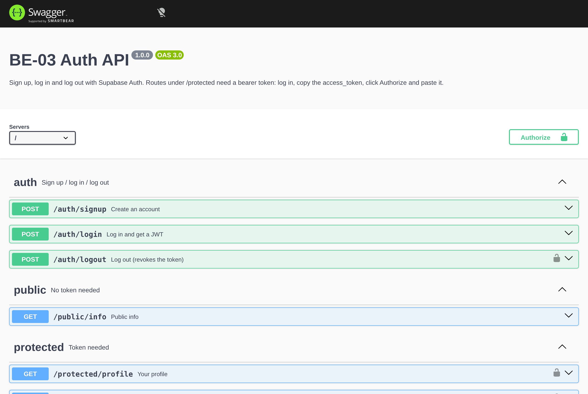
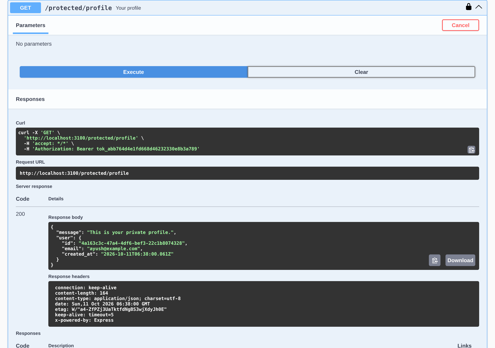

# Auth - Login & protect (BE-03)

An Express API where users sign up, log in and log out through Supabase Auth,
and some routes only open for a valid JWT. Up to now my APIs were wide open to
anyone with the URL; this one checks who's asking.

How it fits together: the client sends email + password to my server, my server
forwards them to Supabase, Supabase answers with a JWT. From then on the client
puts that JWT in `Authorization: Bearer <token>` and my middleware asks Supabase
whether it's still good before letting the request through.

## Setup

You need a free Supabase project. In the Supabase dashboard go to
Project Settings -> API and copy the Project URL and the anon (public) key.

```bash
cp .env.example .env      # then paste the two values in
npm install
npm start
```

`.env` looks like this:

```
SUPABASE_URL=https://xxxx.supabase.co
SUPABASE_KEY=eyJ...        # the anon key
PORT=3000
```

`.env` is in `.gitignore`. Only `.env.example` is committed. The server refuses
to start if either value is missing, and it pings Supabase before listening so a
typo in the key fails straight away instead of on the first login.

When it's up you'll see:

```
Server running and connected to Supabase
http://localhost:3000
```

One Supabase setting matters: by default new projects require email
confirmation, so `POST /auth/signup` returns `201` but no session until the user
clicks the link in the email, and `login` returns `401` until then. For local
testing I turned that off under Authentication -> Providers -> Email ->
"Confirm email". The signup response tells you which case you're in.

## API

| Method | Path | Auth | Success | Errors |
|---|---|---|---|---|
| POST | `/auth/signup` | no | `201` user (+ token if no email confirmation) | `400` missing fields / rejected by Supabase |
| POST | `/auth/login` | no | `200` `access_token`, `refresh_token`, user | `400` missing fields, `401` `Invalid login credentials` |
| POST | `/auth/logout` | **Bearer** | `204` | `401` |
| GET | `/public/info` | no | `200` | - |
| GET | `/protected/profile` | **Bearer** | `200` user from the token | `401` |
| GET | `/protected/dashboard` | **Bearer** | `200` | `401` |
| GET | `/docs` | no | Swagger UI | - |
| GET | `/openapi.json` | no | the spec | - |

The two `401` messages are deliberate and different:

- `{ "error": "Access token required" }` - the header is missing, isn't
  `Bearer ...`, or has nothing after `Bearer`. Nothing was sent to Supabase.
- `{ "error": "Invalid or expired token" }` - there was a token, Supabase
  rejected it (expired, tampered, or revoked by logout).

### Trying it with curl

```bash
# sign up
curl -i -X POST localhost:3000/auth/signup -H "Content-Type: application/json" \
  -d '{"email":"me@example.com","password":"a-decent-password"}'

# log in, grab the token
curl -s -X POST localhost:3000/auth/login -H "Content-Type: application/json" \
  -d '{"email":"me@example.com","password":"a-decent-password"}'

# public, no token
curl -i localhost:3000/public/info

# protected, no token -> 401
curl -i localhost:3000/protected/profile

# protected, with token -> 200
curl -i localhost:3000/protected/profile -H "Authorization: Bearer <paste token>"

# log out -> 204, and the same token now gets 401
curl -i -X POST localhost:3000/auth/logout -H "Authorization: Bearer <paste token>"
```

## Swagger UI

`/docs` is served by `swagger-ui-express` from the spec in `src/openapi.js`.
The spec declares a `bearerAuth` security scheme (`type: http, scheme: bearer`)
and attaches it to every `/protected/*` route and to `/auth/logout`, which is
what makes the Authorize padlock appear.

Log in through `/auth/login` in Swagger, copy the `access_token`, click
Authorize, paste it, then Try it out on `/protected/profile`:





## How the code is laid out

```
src/
├── index.js                 loads .env, pings Supabase, starts the server
├── app.js                   express app, mounts the routers and /docs
├── supabase.js              the one Supabase client (persistSession off, it's a server)
├── openapi.js               the spec for Swagger
├── middleware/requireAuth.js  extracts + verifies the bearer token, sets req.user
└── routes/
    ├── auth.js              signup / login / logout
    ├── public.js            /public/info
    └── protected.js         router.use(requireAuth) then profile + dashboard
test/
├── auth.test.js             end-to-end checks (npm test)
└── fake-supabase.js         local stand-in for the Supabase auth endpoints, tests only
```

Stage 3 had the token check inside the profile route. In Stage 4 I moved it to
`middleware/requireAuth.js` and the protected router just does
`router.use(requireAuth)`, so adding `/protected/dashboard` was four lines and
no auth code. Logout reuses the same middleware, which is why logging out with a
bad token is a 401 rather than a silent 204.

One thing that caught me: `supabase.auth.signOut()` in supabase-js v2 signs out
the client's own stored session. My server doesn't keep sessions (every request
carries its own token), so there's nothing for it to sign out. For logout I call
the same `POST /auth/v1/logout` endpoint the SDK uses, with the caller's token.

## Tests

```bash
npm test
```

Runs 15 checks covering every status code in the brief: 400s for bad input,
401 for missing/malformed/tampered tokens, 201/200/204 on the happy path, and
that a token stops working after logout. By default it runs against
`test/fake-supabase.js`, a tiny Express app that imitates the four Supabase
Auth endpoints this project touches (`/signup`, `/token`, `/user`, `/logout`).
That way the tests are fast and don't create junk users in the real project.

To run the same suite against the real thing:

```bash
REAL=1 SUPABASE_URL=... SUPABASE_KEY=... npm test
```

It will sign up a `test-<timestamp>@example.com` user, so only do that on a
project where that's fine (and with email confirmation off, or login fails).

## Checklist

- [x] Server starts with one command (`npm start`)
- [x] `.env` gitignored, `.env.example` committed, no keys in the repo
- [x] signup `201`, login `200` with JWT, logout `204`
- [x] `400` on missing fields, `401` on wrong credentials / missing / invalid token
- [x] `/public/info` open, `/protected/*` behind middleware
- [x] Swagger UI at `/docs` with the bearer padlock, screenshot above
- [x] One commit per stage (Stage 0 to 6)
