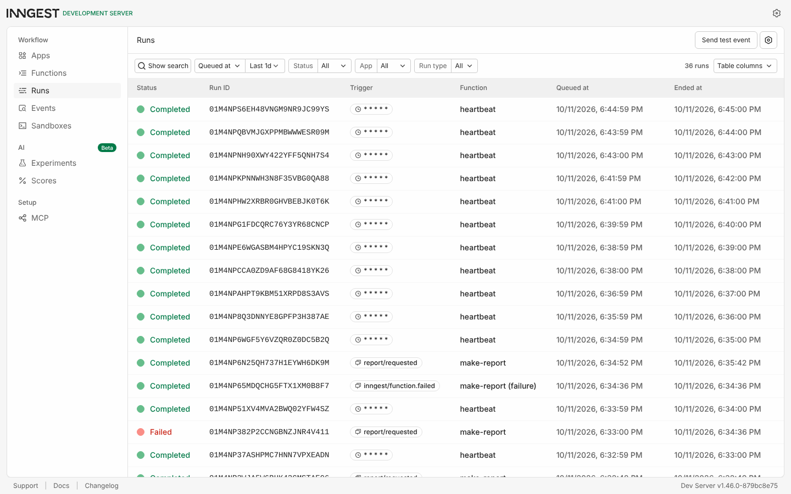
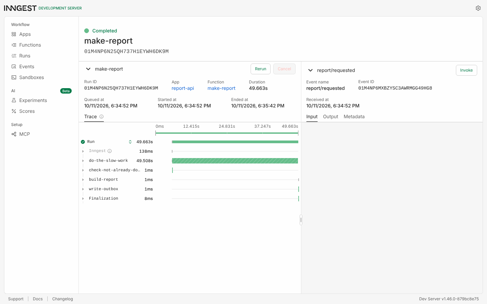
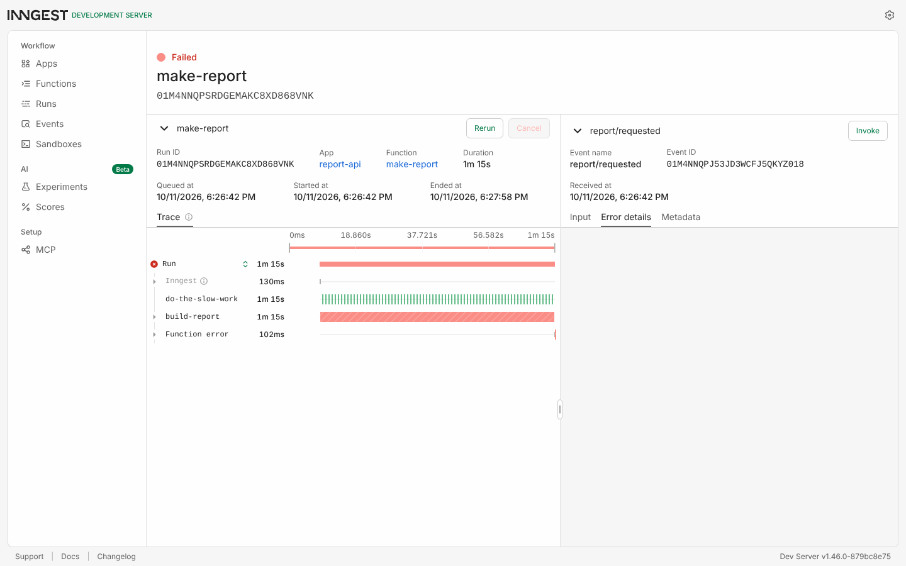

# BE-06 — Your first background job

A tiny report API where the slow part happens in a background job. `POST /reports` answers in
milliseconds with `202` and an id; an Inngest function does the 8-second work; `GET /reports/:id`
flips from `pending` to `done`. A cron function runs every minute with no request at all.

Express 4 + Inngest (v4 SDK) + the local Inngest Dev Server. No account, no card, nothing leaves
the machine.

## Run it (two terminals)

```bash
npm install

# Terminal 1 — the API (the start script sets INNGEST_DEV=1 so the SDK talks to the local Dev Server)
npm start

# Terminal 2 — the Inngest Dev Server + dashboard at http://localhost:8288
npm run inngest:dev
```

Then:

```bash
curl -i -X POST http://localhost:3000/reports -H "Content-Type: application/json" -d '{"topic":"cats"}'
curl http://localhost:3000/reports/<id>        # pending now, done ~8 s later
```

## Endpoints and functions

| Method | Path | What it does |
|---|---|---|
| GET | `/health` | `{"status":"ok"}` |
| POST | `/reports` | Body `{"topic":"cats"}`. Saves a pending report, sends `report/requested`, returns **202** `{id, status:"pending"}` immediately. Missing topic → **400**. |
| GET | `/reports/:id` | The report: `pending` → `done` + `result` (or `failed` + `error`). Unknown id → **404**. |
| GET | `/reports` | All reports and their statuses (extra — the control panel). |
| * | `/api/inngest` | Where the Dev Server talks to the functions. |

| Function | Trigger | What it does |
|---|---|---|
| `say-hello` | event `test/hello` | Stage 1 introductions: sleeps 5 s, returns "Hello from the background!". Invoke it from the dashboard. |
| `make-report` | event `report/requested`, `retries: 2`, `concurrency: 2` | Steps: `check-not-already-done` → `do-the-slow-work` (8 s) → `build-report` → `write-outbox`. Topic `"fail"` throws in `build-report`. `onFailure` marks the report `failed`. |
| `heartbeat` | cron `* * * * *` | Logs one line: how many reports are pending / done / failed. |

Files: `src/server.js` (routes), `src/reports.js` (in-memory store), `src/inngest/client.js`,
`src/inngest/functions.js`.

## Proof: 202 now, done later (Stage 2)

Pasted from my terminal. The POST took 43 ms; the work took 8 s.

```
$ time curl -s -i -X POST http://localhost:3000/reports -H "Content-Type: application/json" -d '{"topic":"cats"}'
HTTP/1.1 202 Accepted
Content-Type: application/json; charset=utf-8
Content-Length: 64

{"id":"91c3ee99-3ce8-4cc2-a446-0d5f04efc821","status":"pending"}

real    0m0.043s

$ curl -s http://localhost:3000/reports/91c3ee99-3ce8-4cc2-a446-0d5f04efc821
{"id":"91c3ee99-3ce8-4cc2-a446-0d5f04efc821","topic":"cats","status":"pending","created_at":"2026-10-11T14:26:02.128Z"}

$ sleep 10; curl -s http://localhost:3000/reports/91c3ee99-3ce8-4cc2-a446-0d5f04efc821
{"id":"91c3ee99-3ce8-4cc2-a446-0d5f04efc821","topic":"cats","status":"done","created_at":"2026-10-11T14:26:02.128Z","result":{"title":"Report on cats","summary":"Everything you need to know about cats, in one paragraph.","generated_at":"2026-10-11T14:26:10.462Z"}}

$ curl -s -i http://localhost:3000/reports/nope | head -1
HTTP/1.1 404 Not Found
```

## Stage 3 — retries, and what does not deserve one

```
$ curl -s -i -X POST http://localhost:3000/reports -H "Content-Type: application/json" -d '{}'
HTTP/1.1 400 Bad Request
{"error":"topic is required"}

$ curl -s -X POST http://localhost:3000/reports -H "Content-Type: application/json" -d '{"topic":"fail"}'
{"id":"f4f6a77b-119d-4b68-8de9-7218956015da","status":"pending"}
# dashboard: make-report run → attempt 1 fails, attempt 2 fails, attempt 3 fails → Failed (14:26:42 → 14:27:58)
# API log: three "Inngest step error: The report oven is broken!" then
[make-report] gave up on f4f6a77b-119d-4b68-8de9-7218956015da: The report oven is broken!

$ curl -s http://localhost:3000/reports/f4f6a77b-119d-4b68-8de9-7218956015da
{"id":"f4f6a77b-...","topic":"fail","status":"failed","created_at":"2026-10-11T14:26:42.372Z","error":"The report oven is broken!"}
```

**The sentence:** a missing topic is a wrong *input* and gets a `400` at the door with no job created,
because retrying it would produce the same `400` forever; the broken oven is a wrong *moment*, and a
retry after a short wait is exactly the right answer for that.

## Stage 4 — the cron heartbeat

```
[heartbeat] 2026-10-11T14:29:00.020Z reports: pending=0 done=1 failed=0
[heartbeat] 2026-10-11T14:30:00.008Z reports: pending=0 done=1 failed=0
```

Two runs, one minute apart, nothing asked for them. Every day at 08:00 is `0 8 * * *`; every Sunday
at 22:00 is `0 22 * * 0` (Sunday is `0`; `7` also works on most systems). Both checked on crontab.guru.
The Dev Server runs cron in UTC, so the daily one would fire at 12:00 in Dubai unless I prefix the
schedule with `TZ=Asia/Dubai`.

## Dashboard

All three functions, from the Dev Server at `localhost:8288`:



A completed `make-report` with its steps — this is the run from the restart experiment, which is why
`do-the-slow-work` spans 49 s (interrupted at 3 s, re-run after the backoff) while the other steps ran once:



The `fail` run from Stage 3: three attempts over 1 m 15 s, then Failed:



## Extras and stretch goals I did

- **`GET /reports`** — the list endpoint.
- **The "email"** — `write-outbox` writes `outbox/<id>.txt` after the report is built, the stand-in for sending mail from a job. (`outbox/` is git-ignored.)
- **Idempotency** — the first step, `check-not-already-done`, returns early if the report is already `done`. I re-sent the same `report/requested` event for a finished report from the Dev Server: the run completed in under a second, skipped the 8-second step, and `generated_at` did not change. Jobs must survive running twice because the same event *will* be delivered twice one day — a retry after a timeout, a replay from the dashboard, a double-click — and the second run must not build, bill or email twice.
- **Concurrency 2** — `concurrency: 2` on `make-report`. I enqueued five reports at once and polled `GET /reports`: at 11 s two were done, at 20 s four, at 29 s all five. Three of them waited in line. You want a queue to be slow when the thing behind it is the bottleneck: an AI provider with a rate limit, a database you don't want trampled, a third-party API that bills per call. The queue is the brake pedal.
- **The restart experiment** — see below, it taught me the most.

### One deviation from the brief, on purpose

The brief suggests `step.sleep("do-the-slow-work", "8s")`. I started with that and the concurrency
limit was invisible: all five reports finished at 11 s. A sleeping step holds no slot — nothing is
running — so Inngest happily "runs" ten of them at once. I changed the slow step to a `step.run`
that awaits an 8-second timer, which is the shape a real AI call has, and the limit became visible.
The 5-second `step.sleep` is still there in `say-hello`.

### The restart experiment (durable, proven)

Start a report, kill the API three seconds into `do-the-slow-work`, count to three, start it again.

First try, before I fixed anything: the job survived (the Dev Server retried the interrupted step
after its backoff, exactly as promised) but then `build-report` threw `Report ... not found in store`
on every attempt, because my in-memory map had been wiped by the restart and the job expected the
row to exist. The run ended Failed. So: Inngest was durable; *my* code was the weak link.

The fix was one idea: the event already carries everything the job needs (`id`, `topic`), so
marking a report done is an **upsert** — recreate the row if the restart lost it. Second try:

```
POST 14:34:52 -> {"id":"5b5505c9-cea4-4917-bd5d-d110cc5cf8b0","status":"pending"}
kill API 14:34:55 (job is 3 s into do-the-slow-work)
restart API 14:34:58
GET right after restart: {"error":"Report not found"}      <- the map is empty
...
GET at 14:35:50: {"id":"5b5505c9-...","topic":"restart","status":"done","result":{...}}
# dashboard: run started 14:34:52, Completed 14:35:42 — check-not-already-done did not run again;
# do-the-slow-work was re-run (it had not finished); build-report and write-outbox ran once.
```

Two sentences on what happened: the job did not die with the server — Inngest kept the run, waited,
and resumed it against the restarted API, re-running only the step that had not finished. What did
die was the pending row in my map, which is the A1 lesson again: in-memory state is for toys, and a
job must be able to finish from what is in the event.

## AI vs me (Stage 6)

I built Stages 0–5 by hand first, then wrote this prompt from memory, without the brief open, and
gave it to an AI assistant in a fresh session. The output is in [`ai-version/`](ai-version/) exactly
as returned (nothing edited; I only added a `.gitignore`).

**My prompt (round 1):**

> I need a small Node.js API where the slow work happens in a background job. Express for the API,
> Inngest for the jobs (the local Inngest dev server, no account).
>
> What it has to do:
> - GET /health returns {"status":"ok"}
> - POST /reports with a JSON body {"topic":"cats"}. It must answer right away with HTTP 202 and
>   {"id": "...", "status": "pending"}. No slow work inside the request. It should save the report in
>   memory (an object/map is fine) and send an Inngest event called report/requested with the id and topic.
> - If topic is missing or empty -> 400 with an error message, and no event is sent.
> - GET /reports/:id returns the saved report. At first status is "pending", later "done" with a
>   result. Unknown id -> 404.
> - An Inngest function make-report triggered by report/requested. It must have at least two steps:
>   a sleep of 8 seconds that stands in for the slow work, then a step that builds the result and
>   marks the report done.
> - If the topic is exactly "fail", the build step throws an error. Retries should be set to 2 so I
>   can watch 3 attempts in the dashboard and then a failed run.
> - A cron function heartbeat that runs every minute and logs one line with how many reports are
>   pending, done and failed.
> - Serve the Inngest functions at /api/inngest. Inngest client id: report-api.
> - CommonJS (require), Express 4, port 3000. Keep it to a few files.
>
> Also tell me the two commands to run (the API and the Inngest dev server).

**Running it.** I ran the AI version on its own Dev Server and fired my Stage 2 and Stage 3
checkpoints at it. `GET /health` 200 ✓. Missing topic 400 ✓. `POST /reports` 202 in 18 ms ✓,
`pending` then `done` after 8 s ✓. Unknown id 404 ✓. Topic `fail`: three attempts, run Failed,
report marked `failed` ✓. So it passed every behaviour checkpoint — once it was running. Getting
it running is where the differences were.

**What the AI did better — and do I understand it?**
It wrapped `inngest.send` in a try/catch and returns `503 Could not enqueue report job` (and marks
the report failed) when the Dev Server is unreachable. Mine falls through to a generic 500. I
understand it and I'd keep it: a 503 tells the client "try again later", a 500 says "I'm broken",
and the difference matters to whoever is polling. It also stored `result: null, error: null,
updatedAt` on every report from the start, so the shape never changes between states — tidier than
my object that grows fields.

**What it got wrong or silently ignored.**
It pinned `inngest@^3.22` and used the SDK v3 signature, `createFunction(opts, { event }, handler)`.
Against the current v4 package that line throws at startup (`"createFunction" expected a handler
function as the second argument`), so the code as delivered does not start on a fresh
`npm install inngest`. It only ran because its own `package.json` pins v3. It also hard-coded
`const PORT = 3000` with no `process.env.PORT` — I did say "port 3000", so that one is on me, but
it's the kind of thing a reviewer would flag. And its `onFailure` reads the error from
`event.data.error.message`, which is the v3 payload shape; under v4 the handler gets `error` directly.

**What my prompt forgot — and what the AI decided for me.**
I never said which SDK version, so it picked the one it knew. I never said what the Dev Server
address was, so it assumed the default port and the `INNGEST_DEV` auto-detection — when I ran it on a
second Dev Server on another port I had to find `INNGEST_BASE_URL` myself. I never specified the
result shape, so it returned a string (`"Report on cats: cats are fascinating..."`) where mine is an
object. I never said anything about idempotency, concurrency, or what happens if the store is wiped
mid-job, so none of that exists — which is fair, it did exactly what I asked and nothing more.

**The rematch.** I rewrote the prompt with the things I'd learned: the exact v4 `createFunction`
shape with `triggers` in the options and `onFailure({ event, error })`, `PORT` from the environment,
`INNGEST_DEV=1` in the start script, the step names and order including the idempotency check, a
`step.run` timer instead of `step.sleep` so concurrency is visible, the result object shape, the
exact 400 and 404 bodies, an upsert on done/failed, and an ISO timestamp in the heartbeat line. The
output is in [`ai-version/rematch/`](ai-version/rematch/). What changed in one sentence: the second
version is structurally the same as my hand-built one — v4 signatures, four steps in my order, an
upsert store, concurrency 2 — which says the first round's gaps were all in my specification, not
in the model.

The real lesson: I could only write the second prompt because I had built the thing and watched it
break first.

## Commits

One per stage, in order: `Stage 0: hello server` → `Stage 1: Inngest connected, first function runs`
→ `Stage 2: 202 + background job + status endpoint` → `Stage 3: retries seen, bad input rejected`
→ `Stage 4: cron heartbeat` → `Extras: list endpoint, outbox file, idempotent build, concurrency 2,
survives restart` → `Stage 5: publish and docs` → `Stage 6: AI vs me`.
